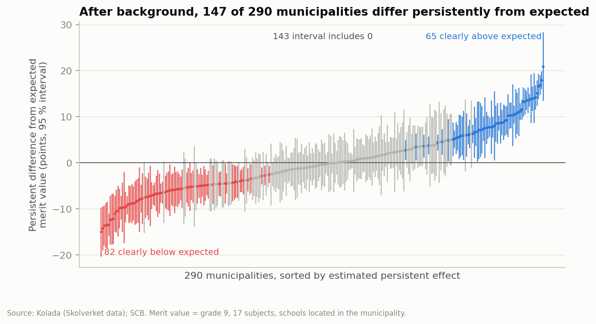
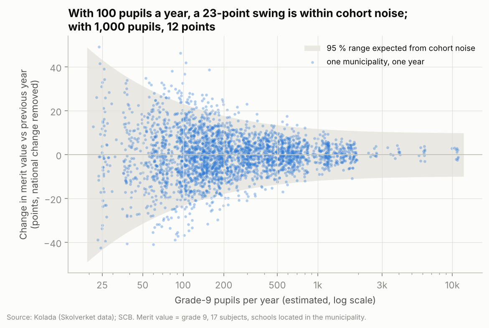

# How much of the municipal school ranking is noise?

Every year Sweden's 290 municipalities are ranked on how their grade-9 pupils do, and education committees react when their municipality moves. This project separates what is persistent from what is noise: about half of the municipalities really do differ from what their pupils' background predicts, but a single year's result — and especially a single year's *change* — is mostly noise, above all in small municipalities.



## Business question
Education committees (utbildningsnämnder) and school directors see their municipality ranked on grade-9 results every year (SKR *Öppna jämförelser*, Skolverket SALSA, local press). **Which municipalities do consistently better or worse than their pupils' background predicts, and how large must a one-year change be before it is more than noise?**

## Key findings
All figures are real data, 290 municipalities × spring terms 2015–2025 (3,190 municipality-years). Intervals are 95 %.

1. **Pupil background explains 53 % of the differences between municipalities** in a given year. Parents' education carries almost all of it; the share of pupils with a foreign background adds nothing once parents' education is in the model (−0.005 points per percentage point, CI −0.10 to 0.09).
2. **A single year is 41 % signal.** The persistent difference between municipalities has SD 6.9 points; year-to-year noise has SD 8.4. Intraclass correlation **0.41 (CI 0.36–0.45)**.
3. **Reliability depends on size.** One year's result reflects the municipality's lasting level with reliability **0.13** for 30 pupils a year, **0.32** for 100, **0.47** for 200 and **0.77** for 1,000. A three-year average lifts these to 0.30 / 0.58 / 0.73 / 0.91.
4. **Half the municipalities do differ persistently:** **147 of 290** are clearly above (65) or below (82) expected over 2015–2025 — ten times the ~14 that chance would produce. The other 143 cannot be told apart from what their background predicts.
5. **Ranks are uncertain:** the median 95 % rank interval spans **102 places** (IQR 65–140). Of the 29 municipalities in the top 10 % in 2025, only **15** are in the persistent top 10 %.
6. **Stockholm county stands out:** **24 of 26** municipalities are persistently above expected, and 22–26 of 26 in every robustness variant. Effects also cluster geographically elsewhere (Moran's I **0.32**, p = 0.001), which points to regional factors the model does not capture.
7. **Robust to the analysis choices:** across eight specifications, 132–156 municipalities differ persistently, and the effects correlate 0.82–1.00 with the primary estimate.



## Recommendation
For an education committee reading this year's ranking:

| Pupils in grade 9 per year | A one-year change smaller than this is within normal noise (95 %) |
|---|---|
| under 50 | ±36 points |
| 50–99 | ±30 points |
| 100–199 | ±22 points |
| 200–499 | ±14 points |
| 500+ | ±9 points |

1. **Do not act on a one-year change inside the band.** In a municipality with 100 pupils a year, a 20-point drop is ordinary.
2. **Judge the level on a three-year average** compared with what background predicts, not on raw rank: for a typical municipality (about 185 pupils a year) that lifts reliability from 0.45 for one year to 0.71.
3. **Compare with peers using intervals.** Where intervals overlap, the ranking between two municipalities is not established.
4. **Treat "above expected" as a question, not as proof of good schools.** The model removes only measured background; regional clustering and the Stockholm pattern show that more is left in the residual.

## Approach
1. **Brief and pre-registration** (`docs/brief.md`, `docs/decisions.md`): outcome, population, covariates and the analysis plan were written down before any model was fitted. Every later change is logged as a diagnostic fix with its evidence (D11–D14).
2. **Data quality** (`docs/data_quality.md`): coverage, suppression, rounding, an internal reconciliation (municipalities add up to the national figure within 0.55 points) and an external one against SCB. SCB's national series is 7–9 points lower every year; the gap is explained: SCB's table is the 16-subject merit value and Kolada's the 17-subject value, and both match Skolverket's published national figures to the decimal.
3. **Descriptives:** rank stability between years (Spearman 0.70–0.81) and a cohort-noise model, change² = a + b/n.
4. **Expected value:** OLS of merit value on parents' education (with a centred square) and foreign background + year fixed effects, standard errors clustered by municipality. Checked against Skolverket's SALSA: expected values correlate 0.82, residuals 0.75.
5. **Persistent vs noise:** random-intercept model (statsmodels MixedLM) and a likelihood with size-dependent noise σ²(n) = c + d/n; empirical-Bayes effects, parametric bootstrap, 10,000 simulated rank draws.
6. **Robustness and space:** eight specifications (home municipality, municipal schools, excluding newly arrived pupils, without 2020–21, SALSA covariate …) and Moran's I with buffered contiguity weights.
7. **SQL and BI layer:** the results are loaded into a SQLite star schema (`sql/01_schema.sql`) and the decision rules are written as SQL views (`sql/02_views.sql`): verdict counts, county summary, this year's change against the noise band, and a municipality card. Tests check that the SQL reproduces the Python results. The views are exported to `reports/bi/` for a Power BI report; the data model, DAX measures and page layout are in [docs/powerbi.md](docs/powerbi.md).

## Data
| Source | Content | Access |
|---|---|---|
| [Kolada](https://www.kolada.se) (RKA), API v3 | Merit value (17 subjects) by school location, home municipality and municipal schools; parents' education, foreign background, pupil counts (Skolverket/SCB data); SALSA values for 4,564 school units | Open API, no key |
| [SCB open geodata – DeSO](https://www.scb.se/vara-tjanster/oppna-data/oppna-geodata/demografiska-statistikomraden-deso/) | DeSO 2025 polygons via SCB's WFS, dissolved to the 290 municipalities | Open, CC0 |
| [SCB Statistical Database](https://www.statistikdatabasen.scb.se) table LE0201Utb/Tema42 | National merit value by sex, for reconciliation | Open API |
| Skolverket's national statistics (PDF reports, 2020–2024) | Published national merit values, 16 and 17 subjects, for reconciliation (`data/reference/`) | Public reports |

- **Population:** pupils in schools located in the municipality (*lägeskommun*), because Kolada publishes pupil background only for that population (D7).
- **Nothing is simulated** except where labelled: rank intervals and the bootstrap are model-based simulations; tests use synthetic data.
- Grade-9 cohort size is estimated as pupils in grades 1–9 ÷ 9; Kolada has no grade-9 count.

## How to run
Python 3.12. The data is already in `data/`; every network step can be rerun.

**macOS/Linux**
```bash
python -m venv .venv && source .venv/bin/activate
pip install -r requirements.txt
python -m pytest
python scripts/run_pipeline.py quality descriptives expected persistence robustness bi
```

**Windows (PowerShell)**
```powershell
py -3.12 -m venv .venv; .venv\Scripts\Activate.ps1
pip install -r requirements.txt
python -m pytest
python scripts/run_pipeline.py quality descriptives expected persistence robustness bi
```

To download the data again: `python scripts/run_pipeline.py probe fetch reconcile` (a few minutes; the school-unit register is fetched municipality by municipality). Seeds are fixed in `src/config.py`. `python scripts/check_readme.py` recomputes the numbers in this README from `reports/`.

## Project structure
```
data/raw/            Kolada extract, SALSA school units, SCB table, municipality map, probe output
data/processed/      panel.csv (290 × 11 years), expected_values.csv
data/reference/      Skolverket's published national merit values (with sources)
docs/                brief, decisions log, data-quality report, QA, Power BI specification
reports/             results as JSON/CSV, figures/, bi/ (star schema and views for Power BI)
sql/                 SQLite schema and the views behind the BI layer
scripts/             run_pipeline.py (all stages), check_readme.py
src/                 Kolada/SCB clients, dataset, quality, descriptives, models, analysis, robustness, figures, bi
tests/               pytest (unit tests, simulated-data checks, end-to-end on a synthetic panel)
```

## Limitations
- **Not value added.** Background is measured at municipality level (grades 1–9), not per pupil, and income, the type of post-secondary education and school choice are not in the model. Residuals contain those as well as anything the schools do.
- **Grading is not standardised.** Merit value is based on teachers' grades, which can differ between schools and regions; part of a persistent effect may be grading practice.
- **Cohort size is estimated** from grades 1–9; the noise model and decision thresholds inherit that approximation.
- **Merit value is the 17-subject measure** (Skolverket's headline figure, incl. modern languages). SCB's 16-subject series is 7–9 points lower; municipalities where fewer pupils take a modern language are slightly disadvantaged by the 17-subject measure.
- **Simplifying assumptions in the uncertainty:** rank intervals ignore uncertainty in the variance parameters and fixed effects; residuals have a small positive year-to-year correlation (0.15), so the thresholds use observed changes rather than the model.
- **Covariate choices are fixed:** see D8 for what was left out and why.

## Technology
Python 3.12 · SQL (SQLite) · Power BI (specification) · pandas · statsmodels (OLS with clustered SEs, MixedLM) · SciPy (custom likelihood) · geopandas · libpysal/esda (Moran's I) · matplotlib · pytest · GitHub Actions (tests and the full pipeline).

## License
Code: MIT. Data: Kolada and SCB open data; see the sources above for their terms.
